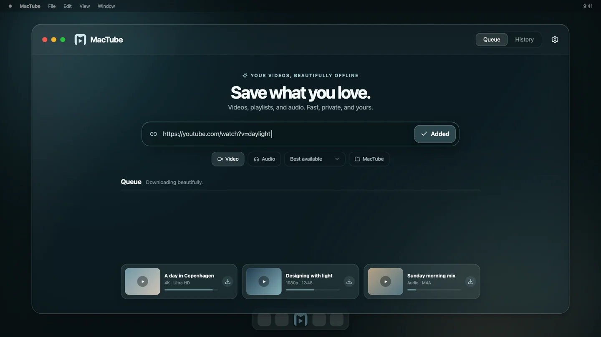

# MacTube

[](https://github.com/Lxvi101/mactube/actions/workflows/ci.yml)
[](LICENSE)
[](#requirements)

**A private, macOS-first downloader for videos, playlists, and audio.** MacTube wraps [yt-dlp](https://github.com/yt-dlp/yt-dlp) and FFmpeg in a focused native desktop experience built with Tauri, Rust, and React.



> [!IMPORTANT]
> Only download media you own or have permission to save. You are responsible for following the source website's terms and applicable law. MacTube is not affiliated with YouTube or Google.

## Highlights

- Download individual videos or complete playlists from sites supported by yt-dlp.
- Choose best available quality or 4K, 1440p, 1080p, 720p, and 480p presets.
- Extract audio to MP3, M4A, Opus, or lossless FLAC.
- Run a persistent, low-memory queue with pause, resume, retry, cancellation, and 1–4 concurrent jobs.
- Search and select playlist items with ranges and per-item format choices.
- Embed metadata and thumbnails, optionally removing SponsorBlock segments.
- Send links from the included Chrome extension through the local `mactube://` URL scheme.
- Use a local Chrome profile for content your signed-in account may access. Cookies remain on your Mac.
- Keep local history, reveal completed files in Finder, and receive native notifications.
- Continue downloading from the menu bar after the main window closes.
- No accounts, analytics, or cloud service.

## Requirements

- macOS 11 or newer
- [Homebrew](https://brew.sh/)
- Node.js 20 or newer and pnpm 10
- Rust stable toolchain
- yt-dlp and FFmpeg

Install the external tools:

```sh
xcode-select --install
brew install node pnpm rust yt-dlp ffmpeg
```

## Run locally

```sh
git clone https://github.com/Lxvi101/mactube.git
cd mactube
pnpm install
pnpm tauri dev
```

Create a local `.app` and `.dmg` with:

```sh
pnpm tauri build
```

MacTube checks common Homebrew locations as well as `PATH`. Set `MACTUBE_YTDLP` to an explicit yt-dlp binary path when needed. The current development build expects yt-dlp and FFmpeg to be installed on the host; distributing self-contained signed sidecars is a separate packaging task.

## Chrome extension

1. Build and launch MacTube once so macOS registers the `mactube://` scheme.
2. Open `chrome://extensions`, enable **Developer mode**, and choose **Load unpacked**.
3. Select this repository's `extension` directory.
4. Pin MacTube and use its toolbar or context-menu actions on a supported page.

The extension only passes the active URL after an explicit action. Enabling **Use Chrome sign-in** makes yt-dlp read the local Chrome profile directly; the extension never copies cookie values. Chrome may need to be closed briefly while its cookie database is locked. DRM-protected media is unsupported.

## Development

```sh
pnpm test             # React and queue tests
pnpm build            # Type-check and bundle the web UI
cargo fmt --check --manifest-path src-tauri/Cargo.toml
cargo clippy --manifest-path src-tauri/Cargo.toml --all-targets --locked -- -D warnings
cargo test --manifest-path src-tauri/Cargo.toml --locked
```

The launch trailer is a reproducible Remotion project:

```sh
pnpm video:studio
pnpm video:render
```

The soundtrack is generated locally with FFmpeg before each render. Rendered media is written to `out/` and is not committed.

See [CONTRIBUTING.md](CONTRIBUTING.md) for the contributor workflow, [docs/ARCHITECTURE.md](docs/ARCHITECTURE.md) for a guided codebase tour, and [CHANGELOG.md](CHANGELOG.md) for release notes.

## Privacy and security

Settings and download history are stored locally in the app configuration directory. MacTube does not operate a server and contains no telemetry. Please report vulnerabilities privately as described in [SECURITY.md](SECURITY.md).

## License

MacTube is available under the [MIT License](LICENSE).
